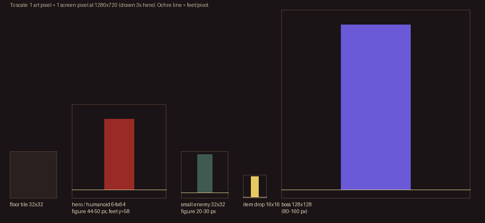
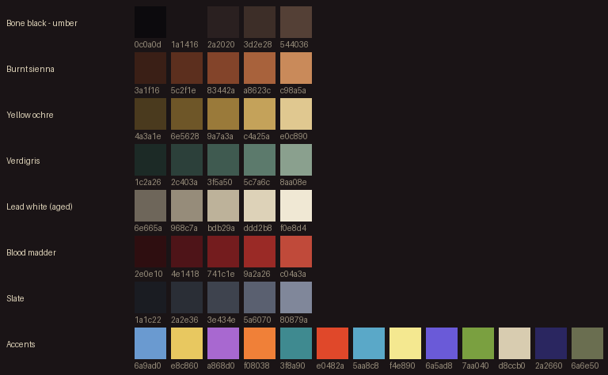

# Path of Dan: art style guide

Your reference when making or generating art. The full visual direction is the Art Bible
("The Dying Canvas v2"); this page is the practical part: sizes, palette, sheet format and
how to hand files over. What still needs making is in [ART_ASSET_LIST.md](ART_ASSET_LIST.md)
(with a ready-to-paste prompt for every sheet).

**In one line:** a forgotten master's oil painting, rendered as 32 px pixel art in a
three-quarter top-down view. Paint it like an Old Master, pixel it like a craftsman,
animate it like a puppeteer.

## 1. Sizes

One art pixel is one screen pixel at 1280x720. Everything is drawn at its final size:
**never draw large and shrink it down**, and never scale a sprite up.

| Asset | Canvas | Figure | Pivot (feet) |
|---|---|---|---|
| Floor tile | 32x32 | - | - |
| Wall | 32 wide; 32 top face + 32-48 front face | - | - |
| Player, humanoid enemies, minions | 64x64 per frame | 44-50 px tall | x=32, y=58 |
| Small enemies (rat, bat, wisp) | 32x32 per frame | 20-30 px | x=16, y=28 |
| Elites | same canvas | +10-15% height, wider, drawn at that size | |
| Bosses | own canvas, 96-160 px | 80-160 px | bottom centre, 8 px up |
| Item drops on the floor | 16x16 | | |
| Inventory and skill icons | 32x32 (shown at 2x in the UI) | | |

Why the game can do this without changing any gameplay is in
[adr/0001-art-scale.md](adr/0001-art-scale.md).

## 2. Palette

The master palette is `assets/palette/dying_canvas.hex`: 48 colours named after historical
pigments (7 ramps of 5, plus the rarity, life/mana and element colours). Every asset uses
only these colours. Glowing VFX may add brighter glow colours on top.

- Scene target: about 70% earth neutrals, 20% material highlights and cool accents, at most
  10% "fresh paint" (bright magic, rarity and ability colour).
- Floors sit at 15-35% lightness, walls 25-45%, actors 35-85%. An actor never shares a value
  band with the floor beneath it. Check new enemies in greyscale on their tier's floor.
- Each hero has one signature accent the gear can't override: Warrior a madder red tabard,
  Ranger a verdigris hood, Mage an ultramarine sash and glowing hands.

## 3. Drawing rules

- **Light** from the upper left (about 10 o'clock). The game adds a warm rim light from
  torches, so don't paint one in.
- **Outline:** 1 px "selective" outline. Use the darkest shade of the material on the lit side,
  and near-black `#0c0a0d` on the shadow side and at the feet. Never pure black all round.
  No outline on floor tiles.
- **Shading:** 4-6 shades per material. Highlights shift toward ochre, shadows toward
  violet-umber, never plain black.
- **Dithering** only on broad surfaces (cloth, stone, sky glow): at most a 2-pixel checker or
  irregular "brush" clusters. Never on faces, hands or edges.
- **Anti-aliasing:** by hand, inner edges only. Nothing semi-transparent against the
  transparent background (the ingest tool snaps alpha to on/off anyway).
- **Perspective:** three-quarter top-down. You see the tops of heads; walls show a front
  face and a top.
- **Enemies are distorted, heroes are not.** Enemies get too-long fingers, faces set too low,
  one identifying kind of decay each (see the asset list). The player, allies and hub NPCs
  stay correctly proportioned.
- **Heroes are drawn without weapons.** The equipped weapon is a separate layer.

### Do and don't

| Do | Don't |
|---|---|
| Keep the feet on the same pixel row in every frame | Let the figure drift up or down between frames |
| Make the wind-up of an attack a clear, held pose change | Hide the wind-up in one blurry frame |
| Use a smear frame on fast attacks | Use motion blur or semi-transparent trails |
| Keep strong silhouettes that read in greyscale | Rely on colour alone (each element and rarity also has a shape) |
| Leave transparent space around the figure inside the frame | Let pixels touch the frame edge |
| Use the palette's earth colours for most of the figure | Use pure white, pure black or saturated colour on the body |

## 4. Animation

Held and economical: 10 fps, strong key poses, smears on fast attacks.

| Animation | Frames | Notes |
|---|---|---|
| idle | 4 | breathing loop; enemies may twitch wrongly on one frame |
| run | 6 | loop |
| attack | 5-7 (default 6) | 2-frame wind-up, smear frame at impact, recovery |
| cast | 6 | hands catch fresh-paint colour |
| channel | 4 | loop, beam skills |
| dodge | 6 | roll in the facing direction |
| hit | 2 | first frame flashes to lead white |
| death | 6-8 | ends in pigment flakes; the last frame is the corpse |

**Gameplay drives animation, never the other way round.** Attack, cast and dodge animations
are stretched to the gameplay timing, and the manifest's `impact_frame` is the frame shown
when damage lands:

- Warrior melee: the hit lands 30% into the swing, so frames before the impact frame play
  in that first 30%.
- Projectile and most spell skills fire **at once**, so their release should be frame 0 or 1
  (set `impact_frame` accordingly when the art arrives).
- Enemy attacks: the frames before `impact_frame` fill the whole wind-up (at least 0.3 s,
  often 0.5-0.9 s); the rest play during recovery. The wind-up must read clearly.

## 5. Directions and sheet layout

One PNG per animation. **Rows are directions, columns are frames**, no padding between
frames, transparent background.

| Who | Directions | Rows to draw (top to bottom) |
|---|---|---|
| Player classes | 8 (5 drawn + 3 mirrored) | S, SE, E, NE, N |
| Normal enemies, minions, bosses | 4 (3 drawn + 1 mirrored) | S, E, N |
| Asymmetric designs (e.g. shield arm) | 8 or 4 unmirrored, set `"mirror": false` | S, SE, E, NE, N, NW, W, SW, or S, E, N, W |
| Props, turrets, pets (proposed per item) | 1, 2 or 4 | |

Sheet size = frames x frame width, by rows x frame height. Example: the warrior run is
6 frames of 64x64 in 5 rows, so 384x320.

## 6. Handing files over

1. Save each sheet as `assets/incoming/<id>_<anim>.png`, for example `warrior_run.png` or
   `ghoul_attack.png`. Ids and animation names are in the asset list.
2. Run `python tools/art_ingest.py` (needs Pillow: `pip install pillow`). It:
   - checks the size (and shrinks an exact 2x/3x/4x upscale back down);
   - removes a flat background with `--key-bg`, snaps alpha and removes single stray pixels;
   - snaps colours to the palette with `--quantise`, and tells you how many pixels changed;
   - lines every frame up on the feet line;
   - puts the file in `assets/sprites/<category>/<id>/` and updates `data/art/sprites.json`.

   It never overwrites existing art unless you add `--replace`, and then it keeps a backup in
   `assets/_backup/`.
3. Open Godot once so it imports the new PNGs.
4. Check them in the gallery: open `tests/art_gallery.tscn` and press F6. Press `P` to flash
   any off-palette pixels in magenta.
5. Run `python tools/validate_art.py` for a full check and `python tools/make_asset_list.py`
   to refresh the to-do list.

A new character that isn't in the manifest yet needs
`--category monsters --frames 6 --fallback ghoul` (or similar) the first time.

### Getting good results from SpriteCook or ChatGPT

- Paste the prompt from the asset list as it is; it already holds the size, rows, pivot,
  palette and animation beats.
- Give the tool the approved reference sheet (once we have one: warrior, ghoul, one floor,
  one wall, one icon) as a style reference every time.
- Ask for the exact canvas size. If the tool can only make big images, ask for an exact
  whole multiple (for example 4x) so the ingest tool can shrink it without blurring.
- One animation per image. If a tool can't do all direction rows at once, make one row at a
  time and paste them into one PNG in the S, SE, E, NE, N order.

## 7. Tiles (V2, format fixed now)

Two tileset formats will be accepted:

1. **SpriteCook 15-piece dual-grid** (a 4x4 sheet of 32x32 pieces, one corner empty), for
   floor-against-void and floor-against-wall edges.
2. **Simple kit:** one sheet per tier with 4 floor variants + 2 rare variants, wall top,
   wall front face (32-48 px tall), outer corner, inner corner, doorway and edge pieces.

The first kit (the Forgotten Depths) is 12 families: floor, wall top, wall front, outer
corner, inner corner, doorway, pillar, rubble, candle cluster, brazier, chest and door.

## 8. Placeholders

Until real art exists, `tools/make_placeholder_sheets.py` makes labelled stand-in sheets in
`assets/placeholders/` (silhouette, direction arrow, frame number, impact frame boxed in
ochre). The gallery always shows them. In game they're used only when
`data/render.json` has `"placeholders_in_game": true`, or when Godot is run with
`-- --art-placeholders`. Real art in `assets/sprites/` always wins over a placeholder.
